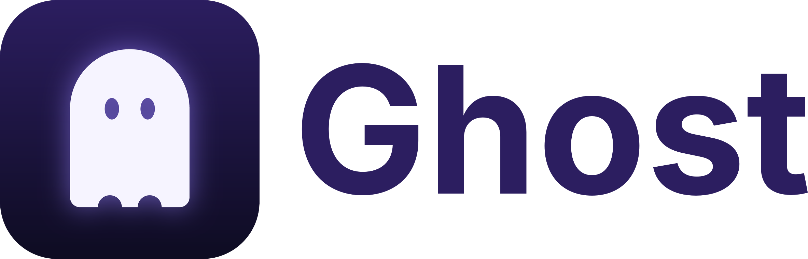

<div align="center">
  

  <p><i>Personal AI, On Personal Devices.</i></p>
</div>

---

Ghost is a framework for local-first personal AI. It runs language models on your own hardware by default and calls cloud APIs only when you choose to. It provides:

- **Shared primitives** for building on-device agents: intelligence, engines, agents, tools & memory, and learning.
- **Evaluations** that treat energy, FLOPs, latency, and dollar cost as first-class constraints alongside accuracy.
- **A learning loop** that improves models and skills from your local trace data.

## Installation

From a source checkout (requires [uv](https://docs.astral.sh/uv/) and Python 3.10–3.13):

```bash
git clone https://github.com/hamz5ashah/Ghost.git
cd Ghost
uv sync --extra dev
```

For local models, install [Ollama](https://ollama.com/) and pull a model. `ghost doctor` reports what is set up and what is missing.

## Quick Start

```bash
ghost                          # start chatting (default: chat-simple)
ghost gui                      # start the graphical browser interface
ghost init --preset <name> --force  # replace config with a starter preset
```

`ghost gui` starts the local API server and frontend, then opens the chat interface in your default browser. It requires Node.js 22+.

> Prefix `ghost ...` with `uv run`, or `source .venv/bin/activate` first.

| Preset | What it does |
|---|---|
| `morning-digest-mac` / `morning-digest-linux` / `morning-digest-minimal` | Spoken daily briefing from email, calendar, health, news |
| `deep-research` | Multi-hop research across indexed docs with citations |
| `code-assistant` | Agent with code execution, file I/O, and shell access |
| `scheduled-monitor` | Stateful agent on a schedule with memory |
| `chat-simple` | Lightweight conversation, no tools |

Example:

```bash
ghost init --preset morning-digest-mac --force
ghost connect gdrive          # one OAuth covers Gmail / Calendar / Tasks
ghost digest --fresh          # generate and play your first briefing
```

### Skills

Skills teach agents how to better use tools and improve their reasoning. Every skill is a tool — agents discover them from a catalog and invoke them on demand.

```bash
# Install skills from public sources
ghost skill install hermes:arxiv
ghost skill sync hermes --category research

# Use skills with any agent
ghost ask "Use the code-explainer skill to explain this Python code: for i in range(5): print(i*2)"

# Optimize skills from your trace history
ghost optimize skills --policy dspy

# Benchmark the impact
ghost bench skills --max-samples 5 --seeds 42
```

Skills can be imported from [Hermes Agent](https://github.com/NousResearch/hermes-agent), [OpenClaw](https://github.com/openclaw/skills), or any GitHub repo, and follow the [agentskills.io](https://agentskills.io/specification) open standard.

### Built-in Agents

| Agent | Type | What it does |
|-------|------|-------------|
| `morning_digest` | Scheduled | Daily briefing from email, calendar, health, news — with TTS audio |
| `deep_research` | On-demand | Multi-hop research with citations across web and local docs |
| `monitor_operative` | Continuous | Long-horizon monitoring with memory, compression, and retrieval |
| `orchestrator` | On-demand | Multi-turn reasoning with automatic tool selection |
| `native_react` | On-demand | ReAct (Thought-Action-Observation) loop agent |
| `operative` | Continuous | Persistent autonomous agent with state management |
| `native_openhands` | On-demand | CodeAct — generates and executes Python code |
| `simple` | On-demand | Single-turn chat, no tools |

Full documentation lives in [`docs/`](docs/) (build locally with `uv run mkdocs serve`).

## Development

```bash
uv sync --extra dev
uv run pre-commit install
uv run pytest tests/ -v
```

## License

Proprietary. Copyright (c) 2026 Syed Hamza Ali Shah. All Rights Reserved. See [LICENSE](LICENSE).
